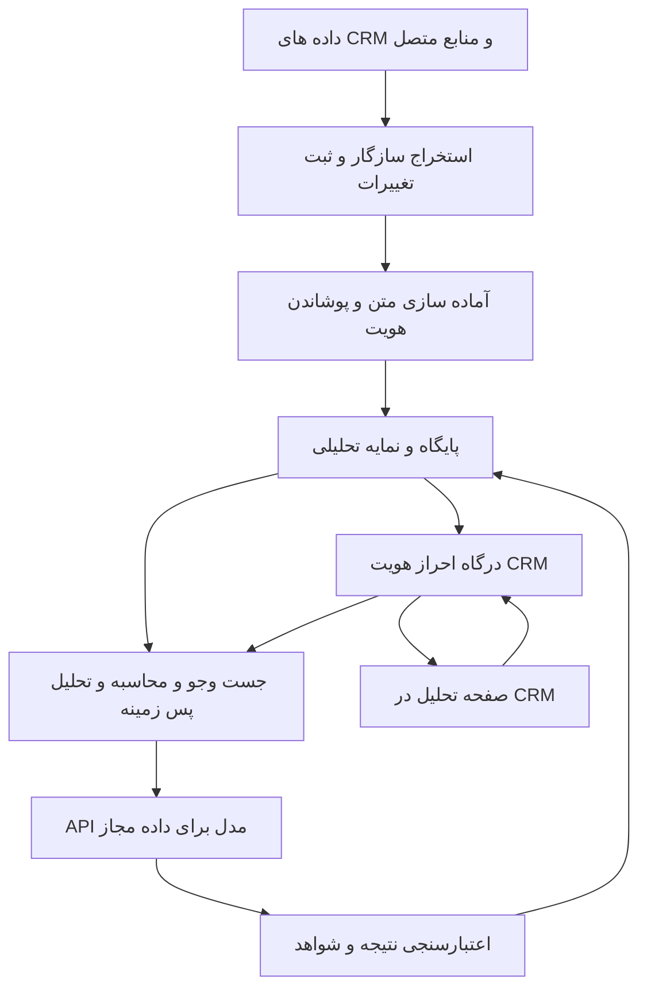

# پلن پیاده سازی تحلیل و هوش مصنوعی CRM

تاریخ تدوین ۲۳ نوامبر ۲۰۲۶

هدف، ساخت یک بخش یکپارچه در CRM برای شناخت ادبیات مخاطب، کشف مسئله‌ها و تجربه‌های واقعی، تحلیل هیجان، تحقیق آزاد و تولید محتوا از داده‌های مستند است. این بخش از اطلاعات ثبت‌شدهٔ ربات‌ها، چت‌بات‌ها، آزمون‌ها و فرم‌ها استفاده می‌کند و امکان انتخاب یک منبع، چند منبع یا ترکیب بخش‌های مرتبط را می‌دهد.

ارسال متن به API مدل پس از پوشاندن مشخصات هویتی، تصمیم تأییدشدهٔ کاربر است. آمار از محاسبات قابل بازتولید به دست می‌آید. کیفیت تفسیر مدل روی نمونه‌های ارزیابی سنجیده می‌شود و موارد مبهم در خروجی مشخص می‌مانند.

## محصول نهایی

| قابلیت | خروجی مورد انتظار |
| --- | --- |
| ادبیات واقعی مخاطب | ابر واژه و عبارت، جدول فراوانی، تغییرات زمانی و نمونهٔ کاربرد |
| چالش‌ها و دردها | دسته‌بندی چندموضوعی، سهم و روند مسئله‌ها، هم‌زمانی موضوعات و شواهد |
| هیجان‌های بیان‌شده | سهم اضطراب، تردید، ناامیدی، خشم، امیدواری و موارد فاقد هیجان مشخص یا نامشخص |
| بانک تجربه‌ها | استخراج روایت‌های واقعی با امکان جست‌وجو، رتبه‌بندی و بررسی متن مبدأ |
| پرسش آزاد فارسی | تحقیق دربارهٔ افراد یا گروه‌های مجاز، استخراج دلخواه، آمار و مقایسهٔ چند بخش |
| تحلیل آزمون | تحلیل پاسخ‌ها و نمره‌ها با راهنمای معتبر هر آزمون و تشکیل گروه‌های قابل مقایسه |
| تولید محتوا | مقاله، روایت، داستان اقتباسی، ایده، تیتر، سناریوی ریلز، پست اسلایدی و پادکست |
| ادامهٔ تحقیق | حفظ فیلترها، شواهد انتخاب‌شده، سابقهٔ نتایج و درخواست‌های پیگیری |
| نتایج قابل بازبینی | منابع، بازه، معیار شمارش، پوشش پردازش، شواهد و نسخهٔ روش تحلیل |

## مبنای اتصال به پروژه فعلی

رابط فعلی با React و TypeScript و Vinext ساخته شده است. CRM از Drizzle و رابط D1 استفاده می‌کند و استقرار مستند فعلی، SQLite محلی پایدار در کانتینر Docker دارد. گزارش‌ها، منابع، نقش مدیران و صفحات جزئیات رکورد در پروژه موجودند.

داده‌های اصلی در جدول‌های sources، contacts، conversations، messages، test_attempts، test_answers، match_profiles، match_answers، ingestion_events و app_settings قرار دارند. نقش پیام، زمان رخداد، منبع و شناسهٔ رکورد، پایهٔ انتساب شواهد خواهند بود.

فهرست منابع تولید و وضعیت اتصال آن‌ها در شروع کار دوباره ثبت می‌شود. منابع جدید HaminAI و تغییرات سمت فرستنده‌ها در همین بررسی پوشش داده می‌شوند. هر فیلدی که هنوز وارد CRM نمی‌شود، در فهرست کمبود اتصال ثبت و بر اساس نیاز قابلیت‌ها تکمیل می‌شود.

قواعد موجود برای گفتگوهای دارای پیام، گروه‌بندی آزمون خط قرمز در پیام‌رسان‌های مختلف و حذف‌های آماری آزمون و فرم، در استخراج تحلیلی بازاستفاده می‌شوند. هر درخواست می‌تواند حالت «گزارش‌های قابل شمارش» یا «بررسی سوابق تاریخی» را انتخاب کند و دامنهٔ انتخاب در نتیجه ثبت می‌شود.

## داده و معنای هر منبع

| نوع داده | استفاده در تحلیل | اطلاعات همراه |
| --- | --- | --- |
| پیام مخاطب | ادبیات، مسئله، تجربه و هیجان بیان‌شده | نقش، گفتگو، منبع، زمان و هویت درون منبع |
| پاسخ ربات | موضوع، لحن، محتوای پاسخ و مقایسه با درخواست مخاطب | مدل ثبت‌شده، پیام و زمینهٔ گفتگو |
| پاسخ متنی آزاد آزمون یا فرم | تحلیل متن در زمینهٔ همان پرسش | شناسه و نسخهٔ پرسش، پاسخ‌دهنده و زمان |
| پاسخ گزینه‌ای | فراوانی انتخاب‌ها و تشکیل گروه بر اساس پاسخ | متن گزینه، کد گزینه و نسخهٔ پرسشنامه |
| نمره و نتیجهٔ آزمون | مقایسه و تفسیر طبق تعریف همان آزمون | مقیاس، روش نمره‌گذاری و راهنمای معتبر |
| تحلیل تولیدشدهٔ قبلی | جست‌وجو و بررسی خروجی ثبت‌شدهٔ مدل | منشأ هوش مصنوعی و ارتباط با آزمون |
| ویژگی‌های مخاطب | فیلتر و مقایسهٔ گروه‌ها | مقدار ثبت‌شده و میزان دادهٔ نامشخص |

هر قطعهٔ قابل جست‌وجو دارای نوع رکورد، شناسهٔ مبدأ، نسخه، منبع، نقش نویسنده، زمان رخداد، زمان دریافت و پیوند شواهد است. متن پرسش، پاسخ مخاطب و تحلیل مدل برچسب منشأ مستقل دارند.

اطلاعات افراد با کلید ترکیبی منبع و شناسهٔ مخاطب نگهداری می‌شود. انتساب چت و آزمون به یک فرد مشترک به نگاشت هویت تأییدشده نیاز دارد. روش و سابقهٔ تأیید این نگاشت ثبت می‌شود. نام مشابه و IP مشترک برای انتساب قطعی کافی نیستند.

در درخواست دربارهٔ یک فرد مشخص، CRM ابتدا هویت و مجوز را محلی حل می‌کند. مدل شناسهٔ مستعار و دادهٔ مجاز همان فرد را دریافت می‌کند.

## تعریف دامنه و محاسبات

هر تحقیق یک دامنهٔ ذخیره‌شده دارد که شامل منابع، نوع داده، نقش نویسنده، بازه، فیلترها، قاعدهٔ شمارش و نسخهٔ داده است. زمان وقوع پیام و تکمیل آزمون مبنای تحلیل زمانی هستند. زمان دریافت برای همگام‌سازی و تشخیص ورود دیرهنگام استفاده می‌شود.

بازه‌های فارسی و تقویم شمسی به مرز زمانی دقیق با منطقهٔ Asia/Tehran تبدیل می‌شوند. مرز ابتدا شامل و مرز انتها خارج از بازه است. مقایسهٔ دوره‌ها، طول دوره و ترکیب منابع را نمایش می‌دهد.

| معیار | تعریف پایه |
| --- | --- |
| تعداد پیام | تعداد پیام‌های واجد شرایط با نقش انتخاب‌شده |
| تعداد گفتگو | تعداد شناسه‌های متمایز گفتگو که در بازه پیام واجد شرایط دارند |
| تعداد مخاطب | تعداد مخاطبان متمایز در هر منبع، همراه با موارد فاقد شناسه |
| مخاطب مشترک چند منبع | تعداد هویت‌های دارای پیوند تأییدشده، با گزارش پوشش تطبیق |
| تعداد آزمون | تعداد تلاش‌های واجد شرایط طبق قواعد فعلی CRM |
| تعداد تجربه | تعداد روایت‌های مستقل دارای شواهد، پس از بررسی هم‌پوشانی |
| سهم چالش در چت | گفتگوهای دارای شواهد چالش تقسیم بر گفتگوهای دارای متن قابل تحلیل |
| سهم هیجان در چت | گفتگوهای دارای شواهد هیجان تقسیم بر گفتگوهای دارای متن قابل تحلیل |
| روند روزانه یا هفتگی | محاسبهٔ همین سهم در هر روز یا هفتهٔ تهران |

در یک بازه، حضور یک موضوع در هر گفتگو یک بار شمرده می‌شود. گفتگو می‌تواند چند موضوع یا هیجان داشته باشد و مجموع سهم‌ها می‌تواند از صد درصد بیشتر شود. در روند روزانه، یک گفتگو در روزهای دارای پیام مرتبط حضور دارد.

برای فرم و آزمون، واحد شمارش با عنوان پاسخ‌دهنده، تلاش یا پاسخ مشخص می‌شود. نمایش ترکیبیِ واحدهای متفاوت در جدول، نوع واحد هر ردیف را حفظ می‌کند. نمره‌های آزمون‌های متفاوت با تعریف مقیاس و نگاشت معتبر قابل ترکیب می‌شوند.

دادهٔ پردازش‌نشده در مخرج نرخِ «نبود چالش یا هیجان» قرار نمی‌گیرد. گزارش وضعیت تعداد واجد شرایط، قابل تحلیل، پردازش‌شده، ناموفق، در انتظار و نامشخص را نمایش می‌دهد. ادعای پوشش کامل به تعیین وضعیت تمام رکوردهای واجد شرایط وابسته است. میزان موفقیت مدل در تشخیص معنایی با مجموعهٔ ارزیابی گزارش می‌شود.

## ادبیات مخاطب و ابر کلمات

حالت پیش‌فرض، پیام مخاطبان و متن‌های آزاد نوشته‌شده توسط آنان است. کاربر می‌تواند نقش نویسنده و نوع منبع را تغییر دهد.

پردازش شامل یکسان‌سازی حروف فارسی و عربی، فاصله و نیم‌فاصله، شناسایی واژه‌ها و استخراج عبارت‌های معنادار است. متن اصلی و نگاشت صورت‌های نوشتاری نگهداری می‌شوند. حذف یا تغییر نشانه‌های نفی، زمینهٔ لازم برای تحلیل معنایی را از بین نبرد.

رابط شامل ابر واژه، ابر عبارت، جدول قابل مرتب‌سازی و پنل شواهد است. جدول تعداد وقوع، تعداد پیام و تعداد گفتگوهای حاوی عبارت را نمایش می‌دهد. اندازهٔ ابر به‌صورت پیش‌فرض از تعداد گفتگوهای حاوی عبارت به دست می‌آید. انتخاب معیار در رابط دیده می‌شود.

واژه‌های عمومی، سلام‌های تکراری و عبارت‌های قالبی در واژه‌نامهٔ قابل تنظیم قرار می‌گیرند. بازفرستادن فنی یک رویداد با شناسهٔ مبدأ تشخیص داده می‌شود. تکرار واقعی عبارت توسط مخاطبان در آمار حضور دارد. عبارت‌های مشابه تنها با قاعدهٔ ثبت‌شده زیر یک گروه قرار می‌گیرند.

## چالش‌ها و هیجان‌ها

برای هر دسته، تعریف، مثال، مرز با دسته‌های نزدیک و موارد مبهم نوشته می‌شود. دسته‌بندی اولیهٔ چالش‌ها شامل ترس از تصمیم ازدواج، تعارض و فشار خانواده، بی‌اعتمادی، تنهایی، مشکلات ارتباطی و فشار اقتصادی است. دسته‌های تازه با نمونه‌های واقعی قابل پیشنهاد و ویرایش هستند.

هر نتیجهٔ مدل، برچسب‌های موضوعی و هیجانی را به قطعه‌های شواهد وصل می‌کند. نفی، زمان گذشته، نقل قول، کنایه و صحبت دربارهٔ دیگری در تشخیص گوینده و معنای نتیجه لحاظ می‌شوند. خوداظهاری مدل دربارهٔ اطمینان به‌تنهایی مبنای نمایش درصد اطمینان نیست. آستانهٔ پذیرش با دادهٔ ارزیابی تنظیم می‌شود.

نمای چالش‌ها سهم، تعداد، تغییر دوره، موضوعات همراه و نمونه‌های مستند را نشان می‌دهد. نمای هیجان‌ها نمودار سهم و روند را برای اضطراب، تردید، ناامیدی، خشم و امیدواری ارائه می‌کند و وضعیت‌های فاقد هیجان مشخص و نامشخص را حفظ می‌کند.

خروجی این نماها دربارهٔ محتوای بیان‌شده است. تفسیر نمرهٔ آزمون از مسیر تعریف همان آزمون انجام می‌شود.

## استخراج تجربه‌های واقعی

واحد استخراج، یک روایت یا رویداد قابل تشخیص در زندگی است. چند پیام ادامهٔ یک روایت می‌توانند یک تجربه بسازند. هر تجربه به پیام‌های پشتیبان، گوینده، موضوع، زمان روایت‌شده در صورت وجود و نوع انتساب وصل می‌شود.

درخواست‌هایی مانند «تجربه‌های عجیب»، «اتفاق‌های سخت» و «تجربه‌های غیرمنتظره» به معیار انتخاب قابل مشاهده تبدیل می‌شوند. معیار اولیه می‌تواند دشواری شرح‌داده‌شده، غیرمعمول‌بودن موقعیت و جزئیات مستند روایت باشد. کاربر می‌تواند معیار را اصلاح کند و نتایج با نسخهٔ جدید آن تولید می‌شوند.

مسیر اجرا به‌ترتیب زیر است.

1. دامنهٔ مخاطب، منابع و بازه تعیین می‌شود.
2. کاندیداها با جست‌وجوی واژه‌ای و معنایی یا مرور گسترده پیدا می‌شوند.
3. پیام‌های زمینه خوانده می‌شوند و روایت خود فرد، روایت دربارهٔ دیگری و موقعیت فرضی برچسب می‌خورند.
4. خلاصهٔ وفادار به متن و قطعه‌های شاهد استخراج می‌شوند.
5. اشاره‌های متعدد به یک رویداد بررسی و به تجربهٔ واحد متصل می‌شوند. موارد مشکوک علامت می‌خورند.
6. نتایج با معیار انتخاب رتبه‌بندی و در فهرست پایدار ذخیره می‌شوند.

کارت تجربه شامل عنوان، خلاصه، علت ارتباط با درخواست، نقل‌قول پوشانده‌شده، نوع انتساب و ارجاع به مبدأ است. اطلاعاتی که کاربر بیان نکرده، در خلاصهٔ مستند به‌عنوان واقعیت وارد نمی‌شود.

درخواست «سه مورد بعدی» از فهرست ذخیره‌شده و نشانگر ادامه استفاده می‌کند. صفحه‌بندی با ترتیب ثابت، شناسهٔ تجربه و شناسهٔ آخرین نتیجه انجام می‌شود. تغییر فیلتر یا معیار، فهرست جدید می‌سازد.

درخواست صد مورد یک عملیات قابل ادامه است. پیشرفت، تعداد کاندیداها و تعداد نتایج تأییدشده نمایش داده می‌شود. اگر صد تجربهٔ واجد شرایط به دست نیاید، تعداد مستند پیدا‌شده و پوشش جست‌وجو اعلام می‌شود. مرور کامل برای ادعای فراوانی کل مجموعه، تمام واحدهای واجد شرایط را پردازش می‌کند.

## آزمون و تحقیق بین بخش‌ها

برای هر آزمون یک مدخل معتبر شامل شناسه، نسخه، سؤال‌ها، گزینه‌ها، روش نمره‌گذاری، مقیاس‌ها و راهنمای تفسیر نگهداری می‌شود. سابقهٔ تحلیل هوش مصنوعی به مدخل آزمون و رکورد اصلی وصل است.

دستیار می‌تواند یک نتیجهٔ آزمون را توضیح دهد، گروهی را بر اساس پاسخ یا نمره انتخاب کند، توزیع نتیجه را مقایسه کند و در صورت وجود پیوند هویتی معتبر، تجربه‌های همان گروه را از گفتگوها استخراج کند.

برای آزمون‌های تکرارشده، قاعدهٔ انتخاب در گزارش ذخیره می‌شود. پیش‌فرض پیشنهادی برای تحلیل «نتیجهٔ هر مخاطب»، آخرین تلاش تکمیل‌شده در بازه است. گزارش تعداد تلاش‌ها، همهٔ تلاش‌های واجد شرایط را می‌شمارد. قاعدهٔ زمانی اتصال آزمون و چت، مانند گفتگوهای پیش یا پس از آزمون، صریحاً ثبت می‌شود.

کمبود راهنمای معتبر، تفسیر همان مقیاس را به وضعیت نیازمند تکمیل منبع می‌برد. آمار پاسخ‌ها و تحلیل بخش‌های دارای راهنما قابل اجرا می‌مانند. مقایسهٔ گروه‌های مستقل، جمعیت و پوشش دادهٔ هر گروه را نمایش می‌دهد. ارتباط آماری با عنوان همان ارتباط گزارش می‌شود.

## دستیار تحقیق آزاد

دستیار یک فهرست قابل فهم از داده‌ها، ستون‌ها، روابط، تعاریف معیار و محدودیت‌های دسترسی دریافت می‌کند. برای سؤال تازه می‌تواند برنامهٔ تحقیق چندمرحله‌ای بسازد و نتیجهٔ هر مرحله را مبنای مرحلهٔ بعد قرار دهد.

| ابزار | مسئولیت |
| --- | --- |
| شناخت منبع و طرح داده | کشف جدول‌ها، فیلدها، پوشش و تعاریف قابل استفاده |
| انتخاب گروه | تبدیل فیلتر فارسی به مجموعهٔ رکورد و مخاطب مجاز |
| جست‌وجوی متن | یافتن عبارت، معنی و متن مرتبط با فیلتر منبع و نقش |
| خواندن زمینه | دریافت قطعه‌های قبل و بعد و رکورد کامل مجاز |
| محاسبه | اجرای کوئری فقط‌خواندنی روی نماهای تحلیلی مجاز |
| تحلیل مجموعه | استخراج یا برچسب‌گذاری همهٔ واحدهای انتخاب‌شده با تعریف کاربر |
| مقایسه | ترکیب نتایج سازگار و نمایش تفاوت جمعیت و معیار |
| گردآوری شواهد | ساخت مجموعهٔ رکوردهای پشتیبان هر ادعا |
| تولید و بازبینی خروجی | ساخت پاسخ و کنترل اعداد، نقل‌قول‌ها و ارجاع‌ها |

طرح محاسبه و کوئری از نظر ستون و جدول مجاز، دامنهٔ دسترسی، توابع مجاز و محدودیت زمان اجرا بررسی می‌شود. پارامترها جداگانه به کوئری داده می‌شوند. ابزار اجرا با نقش فقط‌خواندنی به نماهای تحلیلی دسترسی دارد. عملیات طولانی در صف کار پس‌زمینه ثبت می‌شود.

جست‌وجوی ترکیبی، رتبه‌بندی معنایی و خواندن زمینه برای یافتن شواهد استفاده می‌شوند. سؤال دربارهٔ کل جمعیت یا فراوانی یک موضوع، برنامهٔ مرور مجموعه و محاسبهٔ پوشش می‌گیرد. نتیجهٔ جست‌وجوی چند قطعه با عنوان دامنهٔ جست‌وجو گزارش می‌شود.

سابقهٔ هر جلسه شامل سؤال‌ها، دامنهٔ فعال، برنامهٔ اجرا، شناسهٔ کارها، مجموعهٔ شواهد و فهرست تجربه‌های نمایش‌داده‌شده است. درخواست‌هایی مانند «حالا فقط ایتا»، «همین مقایسه برای ماه قبل» و «از مورد هفتم مقاله بساز» به همین سابقه ارجاع می‌دهند.

## تولید مقاله و محتوای رسانه‌ای

هر خروجی از یک مجموعهٔ شواهد مشخص یا نتایج یک تحقیق ساخته می‌شود. نوع متن، مخاطب، پلتفرم، لحن، طول و تعداد توسط کاربر قابل تعیین‌اند.

| قالب | اجزای قابل درخواست |
| --- | --- |
| مقاله | طرح مقاله، متن، تیتر، آمار و ارجاع شواهد |
| روایت تجربهٔ واقعی | بازنویسی وفادار همراه با سوابق تغییر متن |
| داستان اقتباسی | شخصیت‌های مستعار و مشخص‌بودن عناصر ترکیبی یا تخیلی |
| ایدهٔ رسانه‌ای | مسئلهٔ مخاطب، زاویهٔ پرداخت، قالب و تجربه‌های پشتیبان |
| اینستاگرام | قلاب، سناریوی ریلز، متن اسلایدها، کپشن و دعوت به اقدام |
| پادکست | ایده، عنوان، مقدمه، ساختار بخش‌ها و متن اجرا |

ادعاهای واقعی و اعداد در متن نهایی به شواهد ذخیره‌شده متصل‌اند. تیترها و ایده‌های ساخته‌شده، منشأ پیشنهادی دارند. نقل‌قول دقیق و بازنویسی در خروجی قابل تشخیص‌اند. جزئیات شناسایی‌کننده در روایت و متن نهایی دوباره بررسی و پوشانده می‌شوند.

کاربر می‌تواند از یک مجموعهٔ ثابت شواهد چند قالب بسازد، متن را بازنویسی کند و نسخه‌های آن را ذخیره کند. خروجی گزارش، جدول نتایج و متن تولیدی برای کپی و دریافت فایل فراهم می‌شود.

## معماری پیشنهادی اجرا

معماری پایهٔ پیشنهادی، رابط و درگاه احراز هویت در پروژهٔ فعلی، سرویس تحلیل Python با API داخلی، worker پس‌زمینه و یک پایگاه تحلیلی PostgreSQL با pgvector است. API و worker از یک کد و تصویر کانتینر ساخته می‌شوند. صف کارها در پایگاه تحلیلی نگهداری می‌شود.

PostgreSQL محل ذخیرهٔ دادهٔ مجاز تحلیلی، نتایج، شواهد، جلسات و وضعیت کارهاست. pgvector امکان جست‌وجوی شباهت برداری را در همان پایگاه فراهم می‌کند. انتخاب نمایهٔ تقریبی با آزمون بازیابی و حجم داده انجام می‌شود و محاسبهٔ آمار از جدول‌های واجد شرایط انجام می‌گیرد. [مستندات pgvector](https://github.com/pgvector/pgvector)

سرویس تحلیل و پایگاه آن در شبکهٔ داخلی Docker قرار می‌گیرند. مرورگر از مسیرهای احراز هویت‌شدهٔ CRM استفاده می‌کند. شناسه و نقش کاربر و دامنهٔ داده با اعتبارنامهٔ داخلی به سرویس تحلیل منتقل می‌شوند.

انتخاب مدل زبانی و مدل بردارسازی با پایلوت قطعی می‌شود. مدل زبانی باید فارسی محاوره‌ای، زمینهٔ گفتگو، خروجی ساختاریافته و کار با ابزارها را پشتیبانی کند. مدل بردارسازی روی بازیابی فارسی سنجیده می‌شود. نسخهٔ مدل، دستور، دسته‌بندی و آماده‌سازی متن همراه هر نتیجه ثبت می‌شود.

### دریافت اولیه و تغییرات بعدی

دریافت اولیه از یک نسخهٔ سازگار از پایگاه فعال انجام می‌شود و خروجی جدول‌ها و فیلدهای مجاز به لایهٔ تحلیل می‌رود. در استقرار SQLite فعلی، Online Backup ابزار ساخت نسخهٔ سازگار است. [مستندات SQLite](https://www.sqlite.org/backup.html)

دفتر تغییرات دارای شمارهٔ ترتیبی پایدار برای درج، ویرایش، حذف و تغییر وضعیت آماری ایجاد می‌شود. ثبت تغییر مرتبط با تکمیل پردازش رویداد یا عملیات مدیریتی، اتمیک انجام می‌شود. برای عملیات چندمرحله‌ای موجود، نشانگر تکمیل مانع تحلیل نهایی رکورد نیمه‌کامل می‌شود. batch در D1 امکان اجرای تراکنشی دستورهای مرتبط را فراهم می‌کند. [مستندات D1](https://developers.cloudflare.com/d1/worker-api/d1-database/)

دریافت اولیه، شمارهٔ دفتر تغییرات همان نسخه را نگهداری می‌کند و سپس از آن شماره ادامه می‌دهد. زمان قدیمی رخداد باعث جاافتادن دادهٔ دیررس نمی‌شود. در بازیابی پایگاه یا تعویض مجموعهٔ داده، شناسهٔ نسل داده عوض می‌شود و تطبیق مجدد انجام می‌گیرد.

worker پس از ذخیرهٔ موفق، نشانگر پردازش را جلو می‌برد. اجرای مجدد یک تغییر با کلید رکورد و نسخه، اثر تکراری ایجاد نمی‌کند. تطبیق دوره‌ای تعداد و اثرانگشت محتوا، موارد جامانده و تغییرات بیرون از جریان اصلی را پیدا می‌کند.

نتایج، بردارها و شواهد به نسخهٔ رکورد مبدأ وابسته‌اند. ویرایش، حذف، تغییر مجوز یا خروج رکورد از آمار، وضعیت وابستگی‌ها و حافظهٔ موقت را به‌روز می‌کند. نتیجهٔ ذخیره‌شده، زمان داده و وضعیت اعتبار فعلی خود را نشان می‌دهد.

### ساختار دادهٔ تحلیلی

| گروه داده | اجزای اصلی |
| --- | --- |
| نسخهٔ منبع و همگام‌سازی | نسل داده، شناسهٔ منبع، نشانگر تغییر و زمان تطبیق |
| رکوردها و قطعه‌های متن | شناسهٔ مبدأ، نسخه، نقش، متن پوشانده‌شده، موقعیت و اثرانگشت |
| اطلاعات آزمون | تلاش، پاسخ، نمره، نسخهٔ آزمون و راهنمای تفسیر |
| پیوند هویت | شناسه‌های مستعار، مبنای تطبیق و وضعیت تأیید |
| دسته‌بندی و نتایج | تعریف برچسب، نسخهٔ روش، نتیجه و وضعیت ابهام |
| تجربه و شواهد | تجربهٔ مستقل، پیام‌های پشتیبان، نوع انتساب و هم‌پوشانی |
| اجرا و کار پس‌زمینه | دامنه، وضعیت، پیشرفت، خطا، تلاش مجدد و هزینه |
| جلسه و فهرست نتیجه | سابقه، فیلتر، ترتیب ثابت، نشانگر ادامه و موارد دیده‌شده |
| گزارش و محتوای تولیدی | نسخهٔ خروجی، شواهد، تنظیمات نگارش و زمان داده |

### پایداری پردازش

هر کار دارای وضعیت در انتظار، در حال اجرا، تکمیل‌شده، ناموفق یا لغوشده است. worker کار را با مهلت مالکیت دریافت می‌کند. مهلت منقضی‌شده امکان ادامه پس از قطع سرویس را می‌دهد.

کلید یکتای پردازش از نوع کار، نسخهٔ داده، اثرانگشت محتوا و نسخهٔ مدل و دستور ساخته می‌شود. پاسخ ساختاریافته پیش از ثبت اعتبارسنجی می‌شود. تلاش مجدد برای خطاهای موقت API محدود و با فاصلهٔ افزایشی انجام می‌گیرد. رکوردهای ناموفق و علت آن‌ها در پنل پردازش دیده می‌شوند.

گزارش‌های طولانی به نسخهٔ مشخصی از داده متصل‌اند تا صفحه‌بندی، شمارش و شواهد به یک مجموعهٔ سازگار ارجاع دهند. مسیر گزارش ذخیره‌شده می‌تواند وضعیت «دادهٔ تازه موجود است» را نمایش دهد.

## رابط و مسیرهای پیشنهادی

ورودی اصلی در /analysis قرار می‌گیرد و همان پوسته، فونت، زبان و الگوی دسترسی CRM را استفاده می‌کند. نماها شامل نمای کلی، زبان مخاطب، چالش‌ها، هیجان‌ها، بانک تجربه‌ها، دستیار تحقیق و کارگاه محتوا هستند.

فیلترهای مشترک شامل چند بخش، چند منبع، پیام‌رسان، بازه، نقش نویسنده، سن، جنسیت، مکان ثبت‌شده و در صورت نیاز نوع آزمون و نتیجه‌اند. مقدار نامشخص مشخصات مخاطب در پوشش فیلتر گزارش می‌شود.

پنل شواهد، متن مجاز و پیوند رکورد اصلی را نشان می‌دهد. وضعیت پردازش، هزینهٔ مصرف‌شده، امکان لغو و ادامهٔ نتیجه در همان محیط دیده می‌شوند. دسته‌بندی‌ها و معیار استخراج دلخواه از داخل تحقیق قابل تعریف‌اند.

| مسیر پیشنهادی | مسئولیت |
| --- | --- |
| /api/admin/analysis/catalog | منابع، فیلدها و پوشش داده |
| /api/admin/analysis/overview | آمار پایه و وضعیت همگام‌سازی |
| /api/admin/analysis/runs | ایجاد و مشاهدهٔ تحلیل‌های دسته‌ای |
| /api/admin/analysis/runs/[id] | پیشرفت، نتیجه و لغو کار |
| /api/admin/analysis/sessions | جلسه و سابقهٔ تحقیق |
| /api/admin/analysis/sessions/[id]/messages | پرسش، پیگیری و دریافت پیشرفت پاسخ |
| /api/admin/analysis/evidence/[id] | شواهد با کنترل مجوز جاری |
| /api/admin/analysis/result-sets/[id]/items | صفحه‌بندی پایدار و ادامهٔ تجربه‌ها |
| /api/admin/analysis/content | ساخت و بازنویسی متن از مجموعهٔ شواهد |
| /api/admin/analysis/exports | دریافت گزارش، جدول و متن |

نام دقیق مسیرها هنگام پیاده‌سازی با قرارداد API تثبیت می‌شود. قابلیت و مسئولیت هر مسیر، دامنهٔ تعهد این طرح است.

### بخش‌های کد

| محل پیشنهادی در پروژه | تغییر |
| --- | --- |
| app/analysis و components/analysis | صفحات، نمودارها، چت و پنل شواهد |
| app/api/admin/analysis و lib/analysis | درگاه احراز هویت و قرارداد داده |
| components/crm-shell.tsx | ورودی منوی تحلیل |
| db/schema.ts و drizzle | دفتر تغییرات و دادهٔ لازم برای اتصال تحلیل |
| lib/ingestion.ts و عملیات مدیریتی مرتبط | ثبت تغییرات، تکمیل رویداد و ابطال نتایج وابسته |
| analytics | سرویس Python، worker، مهاجرت پایگاه تحلیلی و آزمون‌ها |
| compose.yaml و deploy | سرویس‌ها، شبکهٔ داخلی، سلامت و پشتیبان‌گیری |

## دسترسی و پوشاندن هویت

خواندن گزارش و شواهد از قواعد فعلی can(read) پیروی می‌کند. اجرای تحلیل و تولید محتوای هزینه‌دار با can(manage) کنترل می‌شود و تنظیمات کلید و بودجه در اختیار owner قرار می‌گیرد. مجوز رکورد هنگام بازیابی شواهد و ادامهٔ نتایج دوباره بررسی می‌شود.

نام، شماره تماس، شناسهٔ کاربری، نشانی، پیوند شخصی، اطلاعات تماس داخل متن و ترکیب‌های شناسایی‌کننده پیش از ارسال به API پوشانده می‌شوند. پرسش کاربر، قطعه‌های زمینه، ورودی بردارسازی و متن ثبت‌شده در لاگ نیز در همین مسیر بررسی می‌شوند. نگاشت شناسهٔ مستعار به فرد، محلی و تحت کنترل CRM نگهداری می‌شود.

پیام مخاطب، پاسخ ربات و متن راهنمای واردشده دارای نقش داده هستند. دستور اجرای ابزار از قرارداد سامانه و درخواست مجاز مدیر می‌آید. کلیدهای API در تنظیمات محرمانهٔ سرور قرار می‌گیرند و ابزارهای مدل به طرح دادهٔ مجاز تحلیلی دسترسی دارند.

سقف مصرف، هزینهٔ هر اجرا و هزینهٔ ماهانه قابل تنظیم‌اند. درخواست بزرگ، برآورد حجم و وضعیت کار را نشان می‌دهد و در قطعه‌های قابل ادامه اجرا می‌شود. بازاستفادهٔ نتایج، اثرانگشت محتوا و پردازش تدریجی، مبنای کنترل هزینه هستند.

## معیارهای کیفیت و تحویل

درستی محاسبات، وفاداری شواهد، کیفیت استخراج معنایی و پایداری عملیات جداگانه سنجیده می‌شوند. مجموعهٔ ارزیابی شامل منابع قدیم و جدید، فارسی محاوره‌ای، گفتگوهای کوتاه و بلند، نفی، نقل تجربهٔ دیگری، آزمون و پرسش‌های خارج از پوشش داده است.

پایلوت با حدود ۵۰۰ واحد نماینده شروع می‌شود. تقسیم نمونه‌ها در سطح مخاطب و گفتگو انجام می‌شود. مجموعهٔ نهایی ارزیابی پیش از تنظیم مدل کنار گذاشته می‌شود. برای دسته‌های کم‌نمونه، نمونه‌گیری هدفمند و گزارش مستقل انجام می‌گیرد. حداقل یک‌پنجم نمونه‌ها توسط دو ارزیاب انسانی بررسی می‌شوند و اختلاف‌ها ثبت می‌شوند.

اعداد کیفیت زیر هدف اولیهٔ پیشنهادی این طرح‌اند. پس از بررسی توافق انسانی در پایلوت، معیار نهایی پیش از آزمون پذیرش تثبیت می‌شود.

| معیار | شرط یا هدف تحویل |
| --- | --- |
| محاسبات | تطابق کامل شمارش و مخرج درصد با کوئری مرجع روی همان نسخهٔ داده |
| نقل‌قول | تطابق تمام نقل‌قول‌های نمایش‌داده‌شده با متن مبدأ و تبدیل‌های ثبت‌شدهٔ پوشاندن هویت |
| دسترسی | تمام سناریوهای منع دسترسی به داده و شواهد در آزمون‌ها موفق باشند |
| صفحه‌بندی | ادامهٔ سه‌تایی و صدتایی روی فهرست ثابت، نتیجهٔ تکراری یا جاافتاده ایجاد نکند |
| پوشش | وضعیت تمام واحدهای واجد شرایط برای اعلام تکمیل تحلیل مشخص باشد |
| موضوع و هیجان | هدف اولیهٔ macro F1 حداقل ۰٫۸۰ همراه با precision و recall هر برچسب |
| تجربهٔ استخراج‌شده | هدف اولیهٔ precision حداقل ۰٫۹۰ برای ارتباط با معیار و وجود تجربهٔ مستند |
| بازیابی تجربه | سنجش recall روی مجموعهٔ محدودِ کامل برچسب‌خورده، با هدف اولیهٔ حداقل ۰٫۸۵ |
| وفاداری پاسخ و مقاله | هدف اولیهٔ حداقل ۹۵ درصد ادعاهای قابل بررسی در ارزیابی انسانی با شواهد معتبر پشتیبانی شوند |
| خطای حساس | شمارش ساختگی، انتساب تجربه به فرد اشتباه و افشای هویت در آزمون پذیرش، نیازمند رفع پیش از انتشارند |
| بازیابی عملیات | قطع worker و اجرای مجدد باعث تجربه، برچسب یا شمارش تکراری نشود |
| رگرسیون CRM | دریافت داده، گزارش‌ها، دسترسی و پشتیبان‌گیری، آزمون‌های مرتبط را بگذرانند |

دقت کل، کیفیت هر منبع و برچسب‌های کم‌نمونه در گزارش ارزیابی جدا دیده می‌شوند. نتیجهٔ فاقد پشتوانهٔ کافی می‌تواند با وضعیت نامشخص یا نیازمند بررسی ارائه شود.

## مراحل پیاده سازی

### مرحله صفر شناخت داده و تثبیت مبنا

کارها شامل ثبت نسخهٔ سورس و استقرار فعال، تهیهٔ نسخهٔ سازگار داده، فهرست‌کردن منابع و اتصال‌ها، بررسی فیلدها و کمبودها، سنجش حجم و منابع سرور و ثبت تعاریف آماری است. پوشاندن دادهٔ محیط توسعه و نگهداری نسخهٔ پیش از تغییر در همین مرحله انجام می‌شود.

خروجی شامل فهرست منابع، فرهنگ داده، قواعد شمارش، کیفیت شناسه و فهرست کمبود اتصال است. معیار پایان، معلوم‌بودن مسیر هر دادهٔ مورد نیاز و امکان بازتولید آمار پایه از نسخهٔ مرجع است.

### مرحله یک پایلوت و انتخاب مدل

مجموعهٔ نمونه تهیه و برچسب‌گذاری می‌شود. تعریف دسته‌ها و معیار تجربه نوشته می‌شود. مدل‌های API و مدل‌های بردارسازی با فارسی واقعی، شواهد و سناریوهای آزاد مقایسه می‌شوند. پوشاندن هویت روی متن و پرسش آزمایش می‌شود.

خروجی شامل انتخاب مدل، نسخهٔ روش، گزارش ارزیابی، حدود هزینه و سرعت، و معیارهای نهایی پذیرش است. بودجه و منابع اجرا بر اساس همین اندازه‌گیری تعیین می‌شوند.

### مرحله دو زیرساخت داده و پردازش

پایگاه تحلیلی، سرویس و worker، قرارداد دسترسی، دفتر تغییرات، دریافت اولیه، ادامهٔ همگام‌سازی، نسخه‌بندی و پنل وضعیت ساخته می‌شوند. مهاجرت‌ها روی محیط آزمایش اجرا می‌شوند.

معیار پایان، تطابق رکوردهای مجاز با نسخهٔ مرجع، دریافت دادهٔ دیررس و ویرایش، پردازش حذف و تغییر قواعد آماری، و ادامهٔ صحیح پس از قطع سرویس است. بار این مسیر روی دریافت دادهٔ CRM اندازه‌گیری می‌شود.

### مرحله سه جست وجو و شواهد

قطعه‌بندی با حفظ نقش و زمینه، جست‌وجوی فارسی، بردارسازی، ترکیب رتبه‌ها، کنترل دامنه و پیوند مبدأ پیاده می‌شوند. داده‌های طولانی با قطعه‌بندی و پوشش ثبت‌شده پردازش می‌شوند.

معیار پایان، بازیابی قابل قبول روی نمونهٔ ارزیابی، تطابق نقل‌قول‌ها و اعمال صحیح فیلتر و دسترسی است. ساخت صد نتیجه با دامنهٔ محدود و ادامهٔ صفحه‌بندی در این مرحله آزمون می‌شود.

### مرحله چهار سه داشبورد تحلیلی

ابر واژه و عبارت، تحلیل چالش‌ها، هیجان‌ها، روندها، مقایسهٔ منابع، تعریف دسته و پنل شواهد ساخته می‌شوند. تحلیل تاریخچه به‌صورت دسته‌ای و تحلیل دادهٔ تازه به‌صورت تدریجی فعال می‌شود.

معیار پایان، تطابق آمار با مرجع، پوشش شفاف، کنترل اثر تکرار، صحت بازهٔ تهران و رسیدن برچسب‌ها به معیار پایلوت است.

### مرحله پنج بانک تجربه و فهرست پایدار

استخراج رویداد و روایت، تشخیص نوع انتساب، بررسی هم‌پوشانی، معیار انتخاب دلخواه، رتبه‌بندی و فهرست نتایج ذخیره‌شده ساخته می‌شوند. درخواست سه‌تایی، ادامهٔ نتایج و صدتایی در رابط و چت پشتیبانی می‌شوند.

معیار پایان، شواهد معتبر برای هر تجربه، رعایت تعداد واقعی، اعلام کمبود نتیجه و صفحه‌بندی بدون تکرار است. کیفیت تجربه‌های غیرمعمول و دشوار با ارزیابی انسانی سنجیده می‌شود.

### مرحله شش دستیار آزاد و تحلیل آزمون

فهرست داده و ابزارهای تحقیق، انتخاب گروه، محاسبه، جست‌وجو، مرور مجموعه و مقایسه به دستیار متصل می‌شوند. راهنمای آزمون‌ها، قاعدهٔ تلاش تکراری، پیوند هویت معتبر و سابقهٔ پیگیری به همین جریان اضافه می‌شوند.

معیار پایان، پاسخ به سؤال‌های تازهٔ خارج از نمونه‌های آماده، تطابق اعداد، ارجاع معتبر و مدیریت درخواست مبهم یا فاقد داده است. تحلیل «همان افراد» با پوشش تطبیق قابل بررسی خواهد بود.

### مرحله هفت تولید محتوا

کارگاه محتوا به مجموعهٔ شواهد و تجربه‌های انتخاب‌شده وصل می‌شود. قالب‌های مقاله، داستان اقتباسی، اینستاگرام و پادکست، تنظیم لحن و طول، بازنویسی و ذخیرهٔ نسخه ساخته می‌شوند.

معیار پایان، وفاداری ادعاهای واقعی و اعداد، مشخص‌بودن اقتباس و تخیل، پوشاندن هویت و امکان پیگیری منبع هر ادعای مستند است.

### مرحله هشت ارزیابی سراسری و استقرار

آزمون پذیرش بسته، سناریوهای قطع و ادامه، بار هم‌زمان، هزینه، دسترسی و رگرسیون اجرا می‌شوند. build، lint و بررسی‌های انتشار فعلی همراه با آزمون‌های اختصاصی تحلیل اجرا می‌شوند. گزارش معیارها و اشکالات باقیمانده تهیه می‌شود.

استقرار با نسخهٔ مشخص، مهاجرت‌های سازگار، پشتیبان پایگاه عملیاتی و تحلیلی و فعال‌سازی تدریجی انجام می‌شود. مسیر بازگشت شامل غیرفعال‌سازی ورودی تحلیل و بازگردانی سرویس‌های تحلیلی به نسخهٔ پیشین است. بازیابی از پشتیبان در محیط آزمایش بررسی می‌شود.

معیار پایان، عبور از شروط پذیرش و صحت اجرای گردش‌های اصلی در محیط مستقر است.

### مرحله نه پایش بهره برداری

تاخیر همگام‌سازی، پوشش تحلیل، خطای API، کارهای ناموفق، هزینه، سرعت و کیفیت نمونه‌های تازه پایش می‌شوند. بازخورد مدیر به رکورد و نسخهٔ تحلیل متصل می‌شود. تغییر مدل و دسته‌بندی، ارزیابی و پردازش مجدد نسخه‌دار دارد.

## سناریوهای پذیرش مبتنی بر درخواست کاربر

| درخواست | نتیجهٔ قابل بررسی |
| --- | --- |
| معضل‌های این گروه از کاربران چیست | تعریف گروه، تعداد داده و مخاطب، چالش‌ها، سهم و شواهد |
| تجربه‌های عجیب یا سخت کاربران را پیدا کن | معیار انتخاب، تجربه‌های مستقل، زمینه و متن مبدأ |
| سه مورد بیاور و بعد سه مورد بعدی | ادامهٔ همان فهرست با ترتیب پایدار و سابقهٔ موارد دیده‌شده |
| صد تجربه بیاور | صد مورد واجد شرایط یا تعداد مستند موجود با وضعیت پوشش |
| بر اساس نتیجهٔ این آزمون تحلیل بده | پاسخ و نمره، نسخه و راهنمای آزمون و تفسیر مستند |
| افراد با این نتیجه چه مسئله‌هایی گفته‌اند | گروه آزمون، قاعدهٔ انتخاب تلاش، پوشش تطبیق هویت و شواهد گفتگو |
| بله و ایتا را در این ماه مقایسه کن | دامنه، آمار هر گروه، سهم‌ها و تفاوت ترکیب داده |
| از این تجربه‌ها مقاله بنویس | متن، اعداد قابل بررسی و ارجاع به تجربه‌های انتخاب‌شده |
| از مورد هفتم یک داستان بساز | اتصال به تجربهٔ هفتم و مشخص‌بودن عناصر اقتباسی و تخیلی |
| ایدهٔ اینستاگرام یا پادکست بده | ایده و قالب متناسب، مسئلهٔ مخاطب و شواهد پشتیبان |
| با دسته‌بندی خودم دوباره تحلیل کن | تعریف نسخه‌دار، دامنه، پیشرفت و نتایج قابل شمارش |
| داده کافی برای سؤال وجود ندارد | بیان بخش قابل پاسخ و کمبود مشخص داده |

## تصمیم‌های اجرایی و وابستگی‌ها

معماری سرویس Python، PostgreSQL و pgvector، پیش‌فرض فنی پیشنهادی این پلن است. ظرفیت و نمایه‌ها در مرحلهٔ صفر و یک با حجم واقعی و بودجه تطبیق داده می‌شوند. نام مدل‌ها و قیمت تمام‌شده پس از اندازه‌گیری پایلوت ثبت می‌شوند.

دسته‌بندی اولیه، آخرین تلاش تکمیل‌شده برای گزارش نتیجهٔ هر مخاطب و اهداف عددی کیفیت، پیش‌فرض‌های پیشنهادی‌اند. معیارها پیش از آزمون نهایی تثبیت می‌شوند. راهنمای معتبر هر آزمون و پیوند هویت تأییدشده، وابستگی تفسیر و تحلیل فردی بین بخش‌ها هستند.

برآورد تقویمی و هزینهٔ پردازش تاریخچه پس از مشخص‌شدن تعداد پیام، طول متن، حجم آزمون، نرخ رشد و منابع سرور در پایان پایلوت ارائه می‌شود. ترتیب وابستگی اجرا از مرحلهٔ صفر تا هشت است و مرحلهٔ نه چرخهٔ بهره‌برداری محصول خواهد بود.

## وضعیت نسخهٔ محلی در ۲ آذر ۱۴۰۵

رابط فارسی تحلیل، درگاه مجوزهای CRM، سرویس Python، صف پایدار، دریافت کامل و تدریجی داده، شواهد، فهرست تجربهٔ قابل ادامه، تحقیق چندمرحله‌ای، محاسبات عددی و کارگاه محتوا پیاده‌سازی شده‌اند. واژه‌نامهٔ قابل تنظیم، انتخاب معیار فراوانی و مرتب‌سازی جدول، راهنماهای نسخه‌بندی‌شده، پیوند تأییدشدهٔ هویت با سابقهٔ تأیید و لغو، انتخاب آخرین تلاش آزمون و بازیابی سابقهٔ تحلیل‌ها در رابط در دسترس‌اند.

مسیرهای مدل با پاسخ‌های ساختگیِ کنترل‌شده، و مسیر اتصال واقعی CRM با دادهٔ ساختگیِ موقت بررسی شده‌اند. تست SQLite، PostgreSQL محلی، کنترل نوع TypeScript، lint، ساخت و بررسی صفحات اصلی اجرا شده‌اند. گزارش شمارش‌ها، دسترسی، نقل‌قول و صفحه‌بندی به این تست‌ها متکی است. این بررسی، اندازه‌گیری کیفیت معنایی یک مدل واقعی نیست.

طبق تصمیم مالک، اتصال API مدل بعداً توسط او انجام می‌شود. راه‌اندازی و متغیرهای لازم در analytics/README.md و نمونهٔ بدون کلید در analytics.env.example آمده‌اند. ابزار ارزیابی مستقل و قرارداد نمونهٔ انسانی در analytics/EVALUATION.md قرار دارند. پس از اتصال مدل، ارزیابی فارسی واقعی، پوشاندن هویت و وفاداری نگارش با همان ابزار و بازبینی انسانی انجام می‌شود.

فرم اتصال مالک اکنون OpenAI / API مدل‌های GPT، Google AI Studio / Gemini، OpenRouter و سرویس سفارشی سازگار را پشتیبانی می‌کند. مدل و اعتبارنامهٔ بردارسازی می‌توانند مستقل باشند. کلیدها فقط در فایل خصوصی محلی ذخیره می‌شوند، در خواندن تنظیمات نمایش داده نمی‌شوند و با تغییر مقصد، انتقال ضمنی کلید قبلی انجام نمی‌شود. تنظیمات بدون تماس مدل ذخیره و پس از پایان تحلیل‌های فعال اعمال می‌شوند. قرارداد هر سه ارائه‌دهنده با حمل‌ونقل شبیه‌سازی‌شده و تنظیمات با آزمون مستقل بررسی شده است؛ اتصال واقعی همچنان به ورود کلید توسط مالک وابسته است.

اطلاعات عملیاتی، راهنماهای معتبر و تأیید پیوندهای هویتی باید از شواهد واقعی خود سامانه تأمین شوند. سامانه برای این داده‌ها مقدار فرضی تولید نمی‌کند. استخراج ادبیات از پاسخ آزاد آزمون به مشخص‌بودن نویسنده و آزادبودن پاسخ در منبع وابسته است؛ گزینه‌ها و متن سؤال وارد فراوانی ادبیات مخاطب نمی‌شوند.

کار روی محیط محلی انجام شده است. انتشار روی سرور، ارزیابی بار واقعی، اجرای کانتینرها و بررسی افزونهٔ pgvector پیش از انتشار احتمالی و پس از تأیید صریح مالک انجام می‌شوند. مسیر جایگزین بردار JSON و رفتار پایگاه PostgreSQL محلی بررسی شده‌اند.
